<!-- This file is made by scripts/build.mjs every day. Edit the script, not this file. -->

<a href="https://p32929.github.io/"><picture><source media="(prefers-color-scheme: dark)" srcset="assets/hero-dark.svg">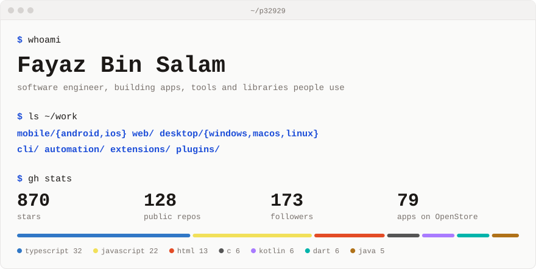</picture></a>

<a href="https://p32929.github.io/">Portfolio</a> · <a href="https://openstore.pfay.workers.dev/dev/p32929">OpenStore</a> · <a href="https://gist.github.com/p32929">Gists</a>

<a href="https://openstore.pfay.workers.dev/dev/p32929"><picture><source media="(prefers-color-scheme: dark)" srcset="assets/h-apps-dark.svg"></picture></a>

<a href="https://openstore.pfay.workers.dev/app/p32929/heartcode"><picture><source media="(prefers-color-scheme: dark)" srcset="assets/app-heartcode-dark.svg">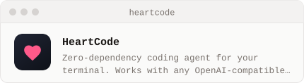</picture></a>
<a href="https://openstore.pfay.workers.dev/app/p32929/let"><picture><source media="(prefers-color-scheme: dark)" srcset="assets/app-let-dark.svg">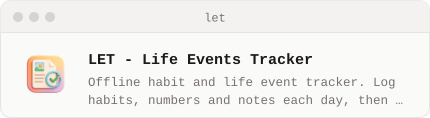</picture></a>

<a href="https://openstore.pfay.workers.dev/app/p32929/opencc"><picture><source media="(prefers-color-scheme: dark)" srcset="assets/app-opencc-dark.svg">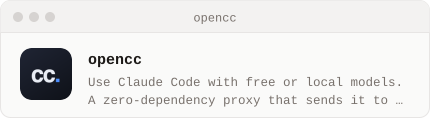</picture></a>
<a href="https://openstore.pfay.workers.dev/app/p32929/oxru"><picture><source media="(prefers-color-scheme: dark)" srcset="assets/app-oxru-dark.svg">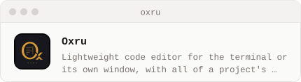</picture></a>

<a href="https://github.com/p32929?tab=repositories&sort=updated"><picture><source media="(prefers-color-scheme: dark)" srcset="assets/h-work-dark.svg"></picture></a>

<a href="https://github.com/p32929/rotato"><picture><source media="(prefers-color-scheme: dark)" srcset="assets/repo-rotato-dark.svg">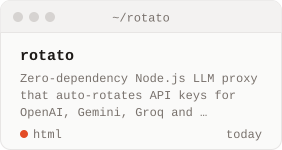</picture></a>
<a href="https://github.com/p32929/Home"><picture><source media="(prefers-color-scheme: dark)" srcset="assets/repo-Home-dark.svg">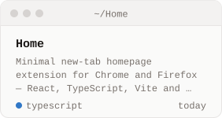</picture></a>
<a href="https://github.com/p32929/obsidotion"><picture><source media="(prefers-color-scheme: dark)" srcset="assets/repo-obsidotion-dark.svg">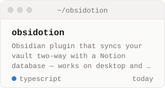</picture></a>

<a href="https://github.com/p32929?tab=repositories"><picture><source media="(prefers-color-scheme: dark)" srcset="assets/h-releases-dark.svg"></picture></a>

<a href="https://github.com/p32929/Home/releases/tag/v1.0.0"><picture><source media="(prefers-color-scheme: dark)" srcset="assets/release-Home-dark.svg">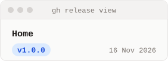</picture></a>
<a href="https://github.com/p32929/obsidotion/releases/tag/v1.1.0"><picture><source media="(prefers-color-scheme: dark)" srcset="assets/release-obsidotion-dark.svg">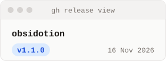</picture></a>
<a href="https://github.com/p32929/roxaruu/releases/tag/v0.2.52"><picture><source media="(prefers-color-scheme: dark)" srcset="assets/release-roxaruu-dark.svg">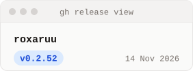</picture></a>

<a href="https://openstore.pfay.workers.dev/dev/p32929"><picture><source media="(prefers-color-scheme: dark)" srcset="assets/h-build-dark.svg"></picture></a>

<code>android/</code> 

<code>web/</code> 

<code>desktop/</code> 

<code>cli/</code> 

<code>extensions/</code> 

<a href="https://openstore.pfay.workers.dev/app/p32929/obsidotion">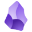</a>

