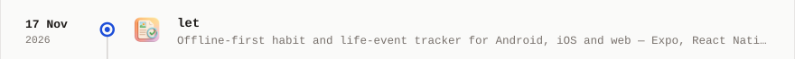
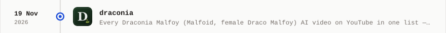
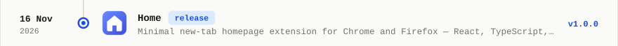

<!-- This file is made by scripts/build.mjs every day. Edit the script, not this file. -->

<a href="https://p32929.github.io/"><picture><source media="(prefers-color-scheme: dark)" srcset="assets/hero-dark.svg"></picture></a>

<a href="https://p32929.github.io/"><picture><source media="(prefers-color-scheme: dark)" srcset="assets/h-links-dark.svg"></picture></a>

<a href="https://p32929.github.io/"><picture><source media="(prefers-color-scheme: dark)" srcset="assets/link-portfolio-dark.svg"></picture></a><a href="https://openstore.pfay.workers.dev/dev/p32929"><picture><source media="(prefers-color-scheme: dark)" srcset="assets/link-openstore-dark.svg"></picture></a>

<a href="https://openstore.pfay.workers.dev/dev/p32929"><picture><source media="(prefers-color-scheme: dark)" srcset="assets/h-fav-dark.svg"></picture></a>

<a href="https://openstore.pfay.workers.dev/cards/p32929/0?n=all&amp;featured=true"><picture><source media="(prefers-color-scheme: dark)" srcset="https://openstore.pfay.workers.dev/cards/p32929/0.svg?n=all&amp;featured=true&amp;theme=dark"></picture></a><a href="https://openstore.pfay.workers.dev/cards/p32929/1?n=all&amp;featured=true"><picture><source media="(prefers-color-scheme: dark)" srcset="https://openstore.pfay.workers.dev/cards/p32929/1.svg?n=all&amp;featured=true&amp;theme=dark"></picture></a> <a href="https://openstore.pfay.workers.dev/cards/p32929/2?n=all&amp;featured=true"><picture><source media="(prefers-color-scheme: dark)" srcset="https://openstore.pfay.workers.dev/cards/p32929/2.svg?n=all&amp;featured=true&amp;theme=dark"></picture></a><a href="https://openstore.pfay.workers.dev/cards/p32929/3?n=all&amp;featured=true"><picture><source media="(prefers-color-scheme: dark)" srcset="https://openstore.pfay.workers.dev/cards/p32929/3.svg?n=all&amp;featured=true&amp;theme=dark"></picture></a> <a href="https://openstore.pfay.workers.dev/cards/p32929/4?n=all&amp;featured=true"><picture><source media="(prefers-color-scheme: dark)" srcset="https://openstore.pfay.workers.dev/cards/p32929/4.svg?n=all&amp;featured=true&amp;theme=dark"></picture></a><a href="https://openstore.pfay.workers.dev/cards/p32929/5?n=all&amp;featured=true"><picture><source media="(prefers-color-scheme: dark)" srcset="https://openstore.pfay.workers.dev/cards/p32929/5.svg?n=all&amp;featured=true&amp;theme=dark"></picture></a> <a href="https://openstore.pfay.workers.dev/cards/p32929/6?n=all&amp;featured=true"><picture><source media="(prefers-color-scheme: dark)" srcset="https://openstore.pfay.workers.dev/cards/p32929/6.svg?n=all&amp;featured=true&amp;theme=dark"></picture></a><a href="https://openstore.pfay.workers.dev/cards/p32929/7?n=all&amp;featured=true"><picture><source media="(prefers-color-scheme: dark)" srcset="https://openstore.pfay.workers.dev/cards/p32929/7.svg?n=all&amp;featured=true&amp;theme=dark"></picture></a> <a href="https://openstore.pfay.workers.dev/cards/p32929/8?n=all&amp;featured=true"><picture><source media="(prefers-color-scheme: dark)" srcset="https://openstore.pfay.workers.dev/cards/p32929/8.svg?n=all&amp;featured=true&amp;theme=dark"></picture></a><a href="https://openstore.pfay.workers.dev/cards/p32929/9?n=all&amp;featured=true"><picture><source media="(prefers-color-scheme: dark)" srcset="https://openstore.pfay.workers.dev/cards/p32929/9.svg?n=all&amp;featured=true&amp;theme=dark"></picture></a> <a href="https://openstore.pfay.workers.dev/cards/p32929/10?n=all&amp;featured=true"><picture><source media="(prefers-color-scheme: dark)" srcset="https://openstore.pfay.workers.dev/cards/p32929/10.svg?n=all&amp;featured=true&amp;theme=dark"></picture></a><a href="https://openstore.pfay.workers.dev/cards/p32929/11?n=all&amp;featured=true"><picture><source media="(prefers-color-scheme: dark)" srcset="https://openstore.pfay.workers.dev/cards/p32929/11.svg?n=all&amp;featured=true&amp;theme=dark"></picture></a> <a href="https://openstore.pfay.workers.dev/cards/p32929/12?n=all&amp;featured=true"><picture><source media="(prefers-color-scheme: dark)" srcset="https://openstore.pfay.workers.dev/cards/p32929/12.svg?n=all&amp;featured=true&amp;theme=dark"></picture></a><a href="https://openstore.pfay.workers.dev/cards/p32929/13?n=all&amp;featured=true"><picture><source media="(prefers-color-scheme: dark)" srcset="https://openstore.pfay.workers.dev/cards/p32929/13.svg?n=all&amp;featured=true&amp;theme=dark"></picture></a> <a href="https://openstore.pfay.workers.dev/cards/p32929/14?n=all&amp;featured=true"><picture><source media="(prefers-color-scheme: dark)" srcset="https://openstore.pfay.workers.dev/cards/p32929/14.svg?n=all&amp;featured=true&amp;theme=dark"></picture></a><a href="https://openstore.pfay.workers.dev/cards/p32929/15?n=all&amp;featured=true"><picture><source media="(prefers-color-scheme: dark)" srcset="https://openstore.pfay.workers.dev/cards/p32929/15.svg?n=all&amp;featured=true&amp;theme=dark"></picture></a>

<a href="https://github.com/p32929?tab=repositories&sort=updated"><picture><source media="(prefers-color-scheme: dark)" srcset="assets/h-new-dark.svg"></picture></a>

<picture><source media="(prefers-color-scheme: dark)" srcset="assets/wn-top-dark.svg"></picture> <a href="https://github.com/p32929/cacheline"><picture><source media="(prefers-color-scheme: dark)" srcset="assets/wn-0-dark.svg"></picture></a> <a href="https://openstore.pfay.workers.dev/app/p32929/draconia"><picture><source media="(prefers-color-scheme: dark)" srcset="assets/wn-1-dark.svg"></picture></a> <a href="https://github.com/p32929/draconia"><picture><source media="(prefers-color-scheme: dark)" srcset="assets/wn-2-dark.svg"></picture></a> <a href="https://github.com/p32929/let/releases/tag/v1.1.0"><picture><source media="(prefers-color-scheme: dark)" srcset="assets/wn-3-dark.svg"></picture></a> <a href="https://openstore.pfay.workers.dev/app/p32929/firstpage"><picture><source media="(prefers-color-scheme: dark)" srcset="assets/wn-4-dark.svg"></picture></a> <a href="https://openstore.pfay.workers.dev/app/p32929/portfolio-v3"><picture><source media="(prefers-color-scheme: dark)" srcset="assets/wn-5-dark.svg"></picture></a> <picture><source media="(prefers-color-scheme: dark)" srcset="assets/wn-bottom-dark.svg"></picture>

<a href="https://openstore.pfay.workers.dev/add"><picture><source media="(prefers-color-scheme: dark)" srcset="assets/h-join-dark.svg"></picture></a>

<a href="https://openstore.pfay.workers.dev/add"><picture><source media="(prefers-color-scheme: dark)" srcset="assets/join-dark.svg"></picture></a>

<a href="https://p32929.github.io/share/"><picture><source media="(prefers-color-scheme: dark)" srcset="assets/link-share-dark.svg"></picture></a><a href="https://p32929.github.io/support/"><picture><source media="(prefers-color-scheme: dark)" srcset="assets/link-support-dark.svg"></picture></a>

