<!-- This file is made by scripts/build.mjs every day. Edit the script, not this file. -->

<a href="https://p32929.github.io/"><picture><source media="(prefers-color-scheme: dark)" srcset="assets/hero-dark.svg"></picture></a>

<a href="https://p32929.github.io/"><picture><source media="(prefers-color-scheme: dark)" srcset="assets/h-links-dark.svg"></picture></a>

<a href="https://p32929.github.io/"><picture><source media="(prefers-color-scheme: dark)" srcset="assets/link-portfolio-dark.svg">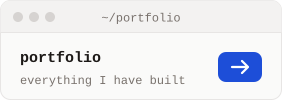</picture></a><a href="https://openstore.pfay.workers.dev/dev/p32929"><picture><source media="(prefers-color-scheme: dark)" srcset="assets/link-openstore-dark.svg">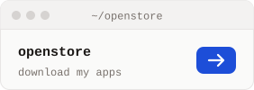</picture></a>

<a href="https://openstore.pfay.workers.dev/dev/p32929"><picture><source media="(prefers-color-scheme: dark)" srcset="assets/h-fav-dark.svg"></picture></a>

<a href="https://openstore.pfay.workers.dev/app/p32929/quran"><picture><source media="(prefers-color-scheme: dark)" srcset="assets/fav-quran_flutter-dark.svg">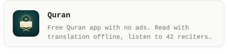</picture></a><a href="https://openstore.pfay.workers.dev/app/p32929/mathfinity"><picture><source media="(prefers-color-scheme: dark)" srcset="assets/fav-mathfinity-dark.svg">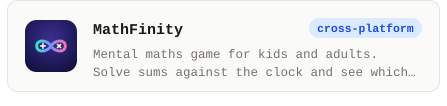</picture></a> <a href="https://openstore.pfay.workers.dev/app/p32929/rotato"><picture><source media="(prefers-color-scheme: dark)" srcset="assets/fav-rotato-dark.svg">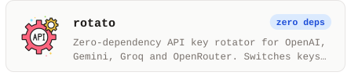</picture></a><a href="https://openstore.pfay.workers.dev/app/p32929/roxaruu"><picture><source media="(prefers-color-scheme: dark)" srcset="assets/fav-roxaruu-dark.svg">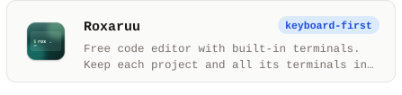</picture></a> <a href="https://openstore.pfay.workers.dev/app/p32929/ollama-models-explorer"><picture><source media="(prefers-color-scheme: dark)" srcset="assets/fav-ollama_models_explorer-dark.svg">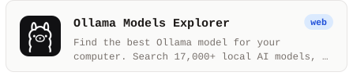</picture></a><a href="https://openstore.pfay.workers.dev/app/p32929/github-trending-repos"><picture><source media="(prefers-color-scheme: dark)" srcset="assets/fav-github-trending-repos-dark.svg">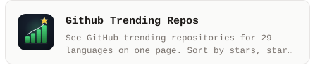</picture></a> <a href="https://openstore.pfay.workers.dev/app/p32929/heartcode"><picture><source media="(prefers-color-scheme: dark)" srcset="assets/fav-HeartCode-dark.svg">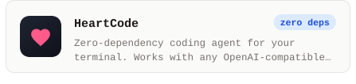</picture></a><a href="https://openstore.pfay.workers.dev/app/p32929/hopper"><picture><source media="(prefers-color-scheme: dark)" srcset="assets/fav-hopper-dark.svg"></picture></a> <a href="https://openstore.pfay.workers.dev/app/p32929/lantern"><picture><source media="(prefers-color-scheme: dark)" srcset="assets/fav-lantern-dark.svg">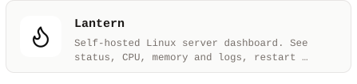</picture></a><a href="https://openstore.pfay.workers.dev/app/p32929/opencc"><picture><source media="(prefers-color-scheme: dark)" srcset="assets/fav-opencc-dark.svg">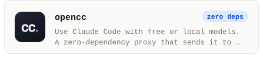</picture></a> <a href="https://openstore.pfay.workers.dev/app/p32929/cccsss"><picture><source media="(prefers-color-scheme: dark)" srcset="assets/fav-cccsss-dark.svg">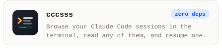</picture></a><a href="https://openstore.pfay.workers.dev/app/p32929/ghcdn"><picture><source media="(prefers-color-scheme: dark)" srcset="assets/fav-ghcdn-dark.svg">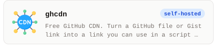</picture></a> <a href="https://openstore.pfay.workers.dev"><picture><source media="(prefers-color-scheme: dark)" srcset="assets/fav-p32929_openstore-dark.svg">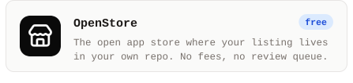</picture></a><a href="https://openstore.pfay.workers.dev/app/p32929/bytebroom"><picture><source media="(prefers-color-scheme: dark)" srcset="assets/fav-bytebroom-dark.svg">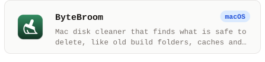</picture></a> <a href="https://openstore.pfay.workers.dev/app/p32929/boom"><picture><source media="(prefers-color-scheme: dark)" srcset="assets/fav-boom-dark.svg">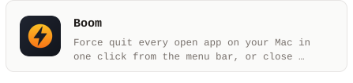</picture></a><a href="https://openstore.pfay.workers.dev/app/p32929/oaifai"><picture><source media="(prefers-color-scheme: dark)" srcset="assets/fav-oaifai-dark.svg">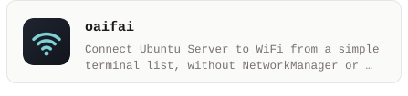</picture></a> <a href="https://openstore.pfay.workers.dev/app/p32929/notes-offline"><picture><source media="(prefers-color-scheme: dark)" srcset="assets/fav-notes-dark.svg">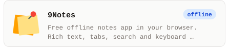</picture></a>

<a href="https://github.com/p32929?tab=repositories&sort=updated"><picture><source media="(prefers-color-scheme: dark)" srcset="assets/h-new-dark.svg"></picture></a>

<picture><source media="(prefers-color-scheme: dark)" srcset="assets/wn-top-dark.svg"></picture> <a href="https://github.com/p32929/roxaruu/releases/tag/v0.2.62"><picture><source media="(prefers-color-scheme: dark)" srcset="assets/wn-0-dark.svg"></picture></a> <a href="https://openstore.pfay.workers.dev/app/p32929/boom"><picture><source media="(prefers-color-scheme: dark)" srcset="assets/wn-1-dark.svg"></picture></a> <a href="https://openstore.pfay.workers.dev/app/p32929/cccsss"><picture><source media="(prefers-color-scheme: dark)" srcset="assets/wn-2-dark.svg"></picture></a> <a href="https://openstore.pfay.workers.dev/app/p32929/oaifai"><picture><source media="(prefers-color-scheme: dark)" srcset="assets/wn-3-dark.svg"></picture></a> <a href="https://github.com/p32929/rotato"><picture><source media="(prefers-color-scheme: dark)" srcset="assets/wn-4-dark.svg">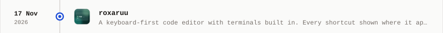</picture></a> <a href="https://github.com/p32929/Home/releases/tag/v1.0.0"><picture><source media="(prefers-color-scheme: dark)" srcset="assets/wn-5-dark.svg"></picture></a> <picture><source media="(prefers-color-scheme: dark)" srcset="assets/wn-bottom-dark.svg"></picture>

<a href="https://openstore.pfay.workers.dev/add"><picture><source media="(prefers-color-scheme: dark)" srcset="assets/h-join-dark.svg"></picture></a>

<a href="https://openstore.pfay.workers.dev/add"><picture><source media="(prefers-color-scheme: dark)" srcset="assets/join-dark.svg">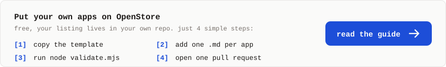</picture></a>

<a href="https://p32929.github.io/share/"><picture><source media="(prefers-color-scheme: dark)" srcset="assets/link-share-dark.svg"></picture></a><a href="https://p32929.github.io/support/"><picture><source media="(prefers-color-scheme: dark)" srcset="assets/link-support-dark.svg"></picture></a>

